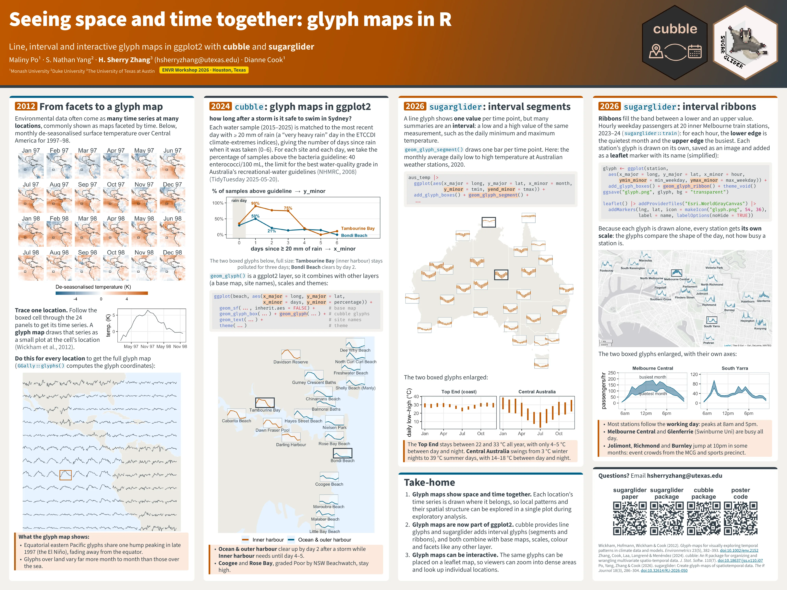
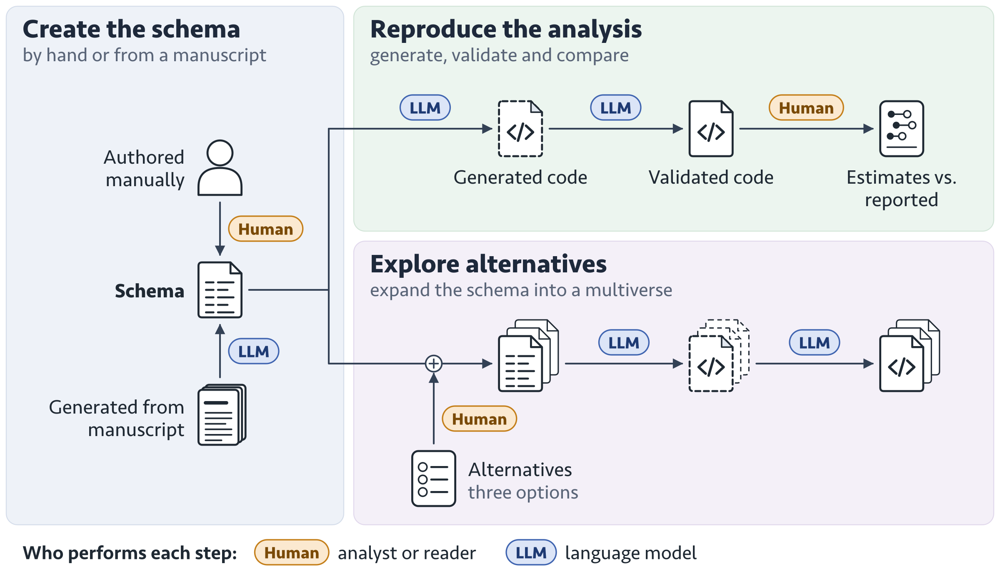

:::column-body

## Overview

My research develops visualization methods and open-source software that make exploratory data analysis easier, more flexible, and more reliable. Modern statistical problems increasingly combine multiple data sources and data types, which places greater demands on data preparation, exploration, and visualization before confirmatory analysis. In applied work, I have found that the decisions behind a published analysis are often scattered across the manuscript, supplement, and code, making it difficult to piece them together or to explore how the results would change under alternative decisions. I therefore also study how large language models (LLMs) can help analysts document and extend these decisions, supporting both reproducibility and the exploration of alternatives.

Themes:

-   [Tidy spatio-temporal data and glyph maps](#glyph-maps)
-   [Projection pursuit, the guided tour, and interactive graphics](#tours)
-   [Transparent data analysis with large language models](#decisions)

## Visualization methods and software

### Tidy spatio-temporal data and glyph maps {#glyph-maps}

Many environmental and ecological data are collected repeatedly over time at fixed locations, and analyses need to move between the spatial and temporal components or study both at once. Much of the methodological work on such data focuses on modelling, but before and alongside modelling, analysts also need to explore the data: to see how temporal patterns vary across locations, to spot unusual locations or periods, and to check whether the data support a model's assumptions. The glyph map is one visualization that shows both at once, drawing each location's time series as a small plot at its geographic position. @fig-glyphmap-poster traces how my work brings glyph maps into the R ecosystem.

```{r fig-glyphmap-poster, echo = FALSE}
#| fig-align: "center"
#| out-width: 100%
#| lightbox: true
#| fig-cap: "Poster presented at the ENVR Workshop 2026, Houston, Texas: Seeing space and time together: glyph maps in R. [Download the PDF](glyphmap-poster.pdf)."

```

Selected work:

-   **cubble**: a tidy data structure for spatio-temporal data that lets analysts switch between spatial and temporal views, with a ggplot2 extension for glyph maps. *Journal of Statistical Software, 2024; ASA [John M. Chambers Statistical Software Award](https://community.amstat.org/jointscsg-section/awards/john-m-chambers).* [](https://doi.org/10.18637/jss.v110.i07) [](https://github.com/huizezhang-sherry/cubble)
-   **sugarglider**: extends glyph maps beyond line glyphs to ribbon and segment glyphs, developed by the undergraduate and master's students I supervised in *Google Summer of Code 2024*. *The R Journal, 2026.* [](https://doi.org/10.32614/RJ-2026-050) [](https://github.com/maliny12/sugarglider)
-   **The ggplot2 extension ecosystem**: an overview for users and developers, with Joyce Robbins (Columbia University) and Gina Reynolds (University of Denver). *Invited submission to WIREs Computational Statistics, minor revision.* [](https://github.com/jtr13/extensions-review)

<!-- Talks: -->

<!-- -   **Switching between space and time: Spatio-temporal analysis with cubble** -->

<!--     -   **customised glyphmap with German weather stations** Institute for Geoinformatics, University of Münster, Germany May 2023 [](https://sherryzhang-germany2023.netlify.app) -->
<!--     -   **customised glyphmap with Austria weather stations** R Ladies Vienna, Austria Apr 2023 [](https://sherryzhang-rladiesvienna2023.netlify.app) -->
<!--     -   **combined with visual diagnostic** Department of Mathematics and Statistics, Maynooth University, Ireland Apr 2023 [](https://sherryzhang-ireland2023.netlify.app/) -->
<!--     -   **targeted audience in econometrics and statistics** The Australian spatial econometrics and statistics workshop, Melbourne, Australia Feb 2023 [](https://sherryzhang-monashspatial2023.netlify.app/) -->
<!--     -   **People's Choice Award** ECSS Miniconference, virtue Nov 2022 [](https://sherryzhang-ecssmini2022.netlify.app/) -->
<!--     -   **invited talk** CANSSI Ontario Statistical Software Conference, virtue Nov 2022 [](https://sherryzhang-canssi2022.netlify.app/) -->
<!--     -   **workshop style with exercises (spatial, temporal, and spatio-temporal data, cubble, and glyph map)** R Ladies Melbourne, Australia Oct 2022 [](https://sherryzhang-rladiesmelb2022.netlify.app) -->

<!-- -   **Cubble: An R package for organizing and wrangling multivariate spatio-temporal data** UseR! 2022 Jun 2022 [](https://sherryzhang-user2022.netlify.app/) -->

### Projection pursuit, the guided tour, and interactive graphics {#tours}

High-dimensional data cannot be seen all at once, but they can be explored through a sequence of low-dimensional projections. A tour animates such a sequence, and projection pursuit guides it towards informative projections by optimizing an index function, which is often non-differentiable and can have local maxima. My work helps understand when this optimization succeeds or fails, by tracing optimizer paths in the projected and original spaces and by characterizing the index functions themselves.

Selected work:

-   **Visual diagnostics for constrained optimisation with application to guided tours** (ferrn). *The R Journal, 2021.* [](https://journal.r-project.org/articles/RJ-2021-105/) [](https://github.com/huizezhang-sherry/ferrn)
-   **Squintability and other metrics for assessing projection pursuit indexes and guiding optimization choices**, which also adds a swarm-based optimizer to the guided tour, with Jessica Leung and collaborators. *Journal of Computational and Graphical Statistics, 2026.* [](https://doi.org/10.1080/10618600.2026.2614076)
-   **A tidy workflow for index composition** (tidyindex): breaks index construction into building blocks, such as dimension reduction or distribution fitting, in the same way that `tidymodels` does for modeling, so that analysts can compare indexes, explore design choices, and quantify index uncertainty. *Journal of Computational and Graphical Statistics, 2025.* [](https://doi.org/10.1080/10618600.2024.2374960) [](https://github.com/huizezhang-sherry/tidyindex)
-   **The state-of-the-art on tours for dynamic visualization of high-dimensional data**, led by Stuart Lee. *WIREs Computational Statistics, 2022.* [](https://doi.org/10.1002/wics.1573)
-   Maintainer, with Dianne Cook and Ian Lyttle, of the CRAN Task View: [Dynamic Visualizations](https://cran.r-project.org/web/views/DynamicVisualizations.html), a curated guide to R packages for dynamic and interactive graphics.

## Transparent data analysis with large language models {#decisions}

Building on a published analysis is often harder than it should be: the decisions behind a result are scattered across the manuscript, supplement, and code, and questions such as how the result would change under a different decision can be difficult to explore. With Roger Peng, I proposed a schema that records each decision and its rationale in plain language, from which LLMs can generate the analysis code. Because each decision is recorded as a separate step, alternative choices can be specified and turned into code, so that the alternatives can be compared directly (@fig-schema-workflow). The schema keeps human judgment at the center of the analysis and leaves LLMs only the mechanical translation into code. We demonstrate it on a published regression analysis and on the many-analysts football study, where it also serves as a reproducibility check. *Under review at the Annals of Applied Statistics.* [](https://github.com/huizezhang-sherry/tines) 
```{r fig-schema-workflow, echo = FALSE}
#| fig-align: "center"
#| out-width: 90%
#| lightbox: true
#| fig-cap: "Overview of the schema-driven workflow. A schema is either authored manually or extracted from a manuscript by an LLM (left). To reproduce the analysis (top), an LLM generates code from the schema and validates it through iterative execution and repair in a sandboxed environment, and the analyst compares its estimates with those reported. To explore alternatives (bottom), an alternative file is merged with the schema to give one schema per alternative, each passed through the same generation and validation. Badges mark whether a step is performed by a human or an LLM."

```

Related work:

-   **Inside Out: externalizing assumptions in data analysis as validation checks**, with Roger Peng. *Journal of Data Science, 2026.* [](https://doi.org/10.6339/25-JDS1206)
-   **An LLM-based pipeline for understanding decision choices from published literature**, applied to air pollution and mortality studies. [](https://github.com/huizezhang-sherry/paper-decisions)

:::
